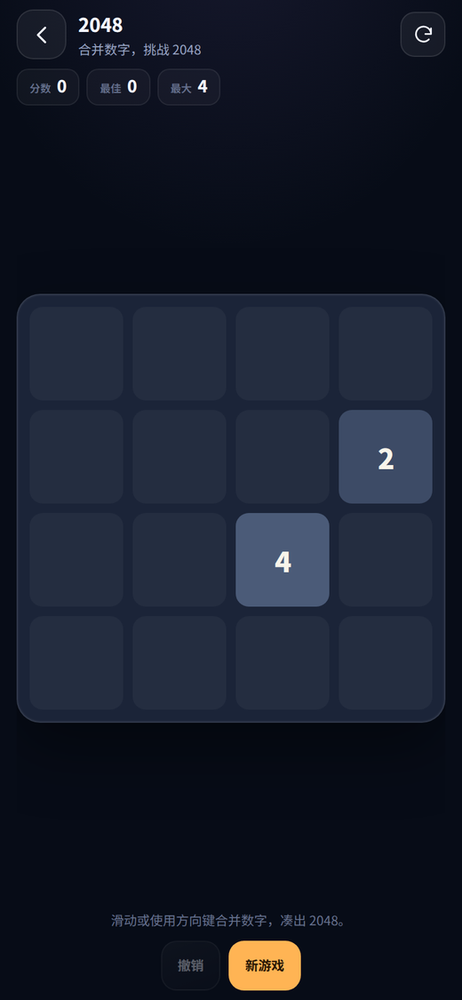
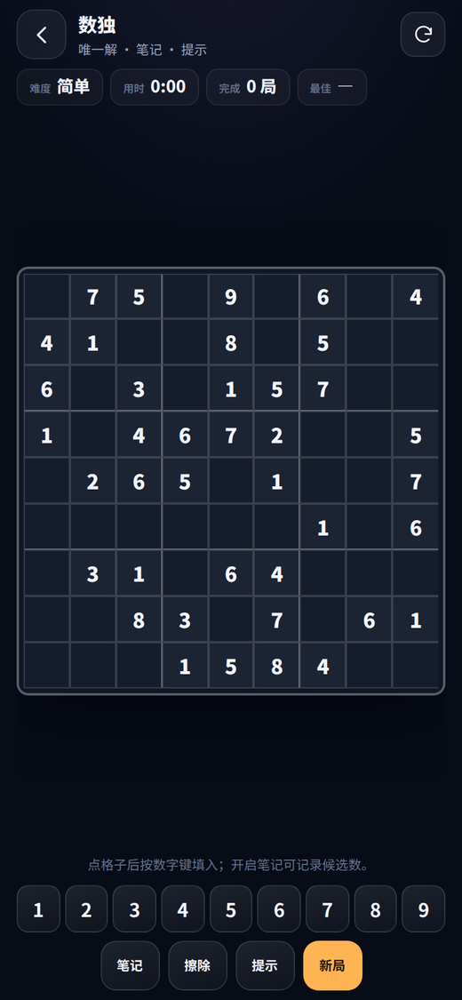

# 口袋游戏厅 · Pocket Arcade

手机优先、离线可玩的单机游戏合集。现在一共 **10 款**：推箱子、俄罗斯方块、跳跃冒险、2048、贪吃蛇、扫雷、打砖块、五子棋、黑白棋、数独。

纯前端、无框架、无构建步骤，打开网页就能玩。

**在线试玩**：https://Qinyike.github.io/pocket-games/<br>
**GitHub**：https://github.com/Qinyike/pocket-games

<p align="center">
  
  
  
  
</p>

## 游戏

### 推箱子 · 24 关
原创关卡，反向生成 + 推动 BFS 验证；滑动、方向键、撤销、选关、最佳步数。

### 俄罗斯方块 · 无尽
7-bag、SRS 旋转与墙踢、暂存、幽灵方块、锁定延迟、连击计分、最高分。

### 跳跃冒险 · 3 关
原创横版跳跃：奔跑、跳跃、踩怪、金币、尖刺、检查点、终点水晶。三个主题关卡，带最佳时间。

### 2048
滑动合并数字，挑战 2048；支持撤销、最高分和继续挑战。

### 贪吃蛇
20×20 棋盘，吃果实变长、逐步加速；方向键、滑动或屏幕方向键。

### 扫雷
初级 9×9 / 中级 12×12 / 高级 14×14；首击安全、长按或开关插旗、最佳时间。

### 打砖块
三关砖墙、三条命、可拖动挡板；打光砖块过关，带最高分记录。

### 五子棋
15×15，你执黑对战 AI；简单/普通难度、悔棋、胜负战绩。

### 黑白棋
8×8 经典翻转棋；合法落点提示、跳子自动处理、简单/普通 AI、胜负战绩。

### 数独
每次生成 **唯一解** 题目；简单/中等/困难、笔记、提示、计时、每档最佳时间与完成局数。

## 声音

- 全部音效由 WebAudio 实时合成：落子、合并、金币、踩怪、地雷、砖块、翻转、过关等。
- 六首原创芯片音乐：大厅、推箱子、俄罗斯方块、跳跃冒险、益智合集、动作合集。
- 设置里可以分别开关「音效」和「背景音乐」，偏好保存在本机。没有使用任何现成游戏的旋律。

## 离线与更新

- Service Worker 预缓存全部页面、脚本、样式和图标，断网也能从桌面图标打开。
- 首页右上角的 **「更新」按钮**：发现新版本时会变成「新版本」，点击后让新 Service Worker 接管并自动刷新；没有更新会显示当前版本。
- 版本号显示在首页脚注和设置面板中。

## 本地运行

需要 Node.js 20+（仅用于开发服务器和测试，游戏本身不需要 Node）。

```bash
npm run dev
# 打开 http://localhost:4173
```

也可以直接用静态服务器：

```bash
python3 -m http.server 4173
```

> Service Worker 需要 `localhost` 或 HTTPS 才能启用。

## 测试

```bash
npm test        # 24 项：关卡、推箱子、俄罗斯方块、平台机器人、七款小游戏逻辑
npm run check   # 核心模块语法检查
```

数独测试会生成题目并验证唯一解；五子棋测试包含 AI 堵四；平台关卡测试用固定物理参数让机器人跑通三关。

## 目录结构

```text
.
├── index.html                  # 单页应用外壳
├── manifest.webmanifest        # PWA 清单
├── sw.js                       # 离线缓存与更新接管
├── src/
│   ├── main.js                 # 路由、设置、首页、更新入口
│   ├── core/                   # 存档、音效/音乐、震动、弹层、版本、更新
│   ├── games/sokoban/          # 推箱子
│   ├── games/tetris/           # 俄罗斯方块
│   ├── games/platform/         # 跳跃冒险
│   ├── games/mini/             # 2048、贪吃蛇、扫雷、打砖块、五子棋、黑白棋、数独
│   └── styles/                 # 各游戏样式
├── scripts/                    # 开发服务器、图标、推箱子关卡生成
├── test/                       # Node 内置测试
└── .github/workflows/          # CI + GitHub Pages 部署
```

## 操作

| 游戏 | 触屏 | 键盘 |
| --- | --- | --- |
| 推箱子 | 滑动棋盘 / 方向键 | 方向键、WASD、`Z` 撤销、`R` 重开 |
| 俄罗斯方块 | 左移 / 右移 / 左转 / 右转 / 下落 / 暂存 / 落下 | 方向键、`Z` 左转、`X` 右转、空格硬降、`C` 暂存、`P` 暂停 |
| 跳跃冒险 | 左 / 右 / 跳跃 | 方向键、A/D、空格/W/↑ 跳跃、`P` 暂停、`R` 重开 |
| 2048 | 滑动 | 方向键、`Z` 撤销、`R` 新局 |
| 贪吃蛇 | 方向键 / 滑动 | 方向键、WASD、`P` 暂停 |
| 扫雷 | 点击 / 长按 / 插旗开关 | — |
| 打砖块 | 拖动挡板 / 左右按钮 | 方向键、空格发球、`P` 暂停 |
| 五子棋 / 黑白棋 | 点击棋盘 | — |
| 数独 | 数字键盘 + 笔记 | 1–9、Backspace、`N` 笔记、方向键选格 |

## 后续可以继续加

- 连连看 / 打地鼠：更轻量的碎片时间游戏
- 中国象棋 / 跳棋：本地双人或简单 AI
- 拼图 / 记忆翻牌：适合做每日挑战
- 赛车 / 跑酷：继续扩展 Canvas 动作类

这些都能复用现在的本地存档、原创音乐、PWA 离线缓存和首页更新机制。

## 说明

「跳跃冒险」是受经典横版平台游戏启发的原创作品；没有使用任天堂或其他商业游戏的角色、关卡、像素图或音乐。所有关卡、视觉和音乐均为本项目原创。

## 许可

代码以 [MIT](LICENSE) 许可发布。
