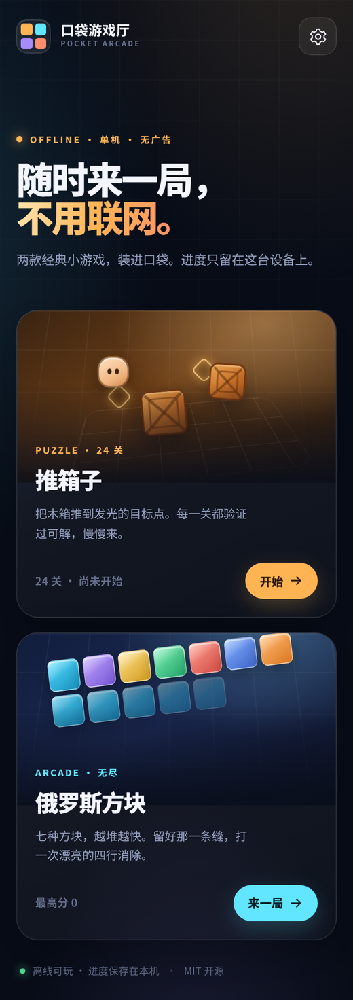
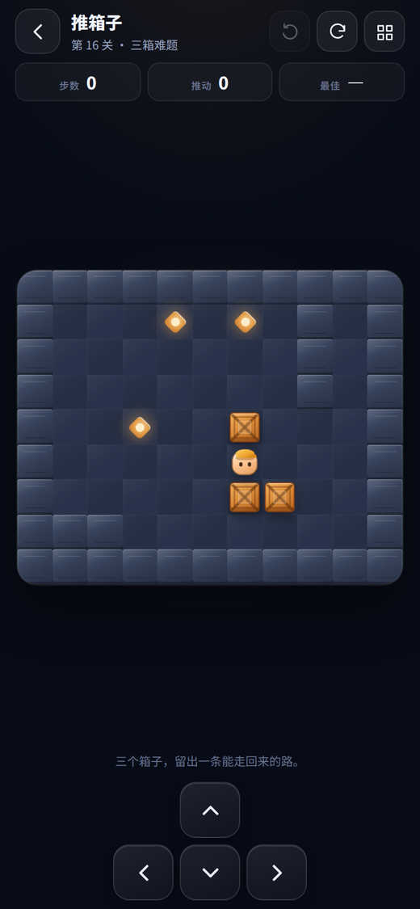
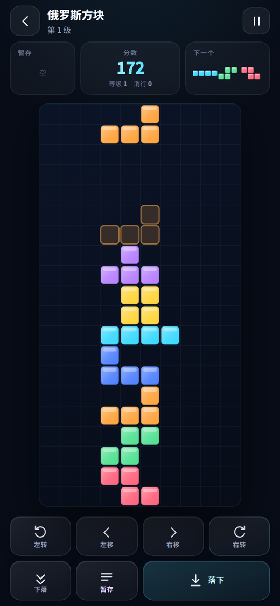

# 口袋游戏厅 · Pocket Arcade

手机优先、离线可玩的单机游戏合集。第一个版本包含 **推箱子** 和 **俄罗斯方块**，纯前端、无框架、无构建步骤，打开网页就能玩。

**在线试玩**：https://Qinyike.github.io/pocket-games/ · **GitHub**：https://github.com/Qinyike/pocket-games

<p align="center">
  
  
  
</p>

## 特性

- **推箱子**：24 个原创关卡，全部由反向生成器产出并通过推动 BFS 验证；支持滑动棋盘、方向键、撤销、重开、选关、最佳步数记录。
- **俄罗斯方块**：7-bag 随机、SRS 旋转与墙踢、暂存、幽灵方块、锁定延迟、连击计分、逐级加速、最高分记录。
- **手机优先**：竖屏为主，横屏自动切换双栏布局；大号触控按钮，适配安全区。
- **离线 PWA**：Service Worker 预缓存全部资源，可添加到主屏幕，断网也能玩。
- **本地存档**：进度只写入 `localStorage`，没有账号、没有后端、没有广告。
- **零运行时依赖**：原生 ES Modules + Canvas，无框架、无打包器。

## 本地运行

需要 Node.js 20+（仅用于开发服务器和测试，游戏本身不需要 Node）。

```bash
npm run dev
# 打开 http://localhost:4173
```

也可以直接用任意静态服务器：

```bash
python3 -m http.server 4173
```

> 注意：Service Worker 需要 `localhost` 或 HTTPS 才能启用。

## 测试

```bash
npm test        # 关卡可解性、par、推箱子逻辑、俄罗斯方块引擎
npm run check   # 入口与核心模块语法检查
```

关卡测试会求解全部 24 关，并断言每关的最少推动次数等于数据中的 `par`。

## 目录结构

```text
.
├── index.html                  # 单页应用外壳
├── manifest.webmanifest        # PWA 清单
├── sw.js                       # 离线缓存
├── src/
│   ├── main.js                 # 路由、设置、首页
│   ├── core/                   # 存档、音效、震动、弹层
│   ├── games/sokoban/          # 推箱子逻辑、关卡、界面
│   ├── games/tetris/           # 俄罗斯方块引擎、界面
│   └── styles/                 # 基础 / 推箱子 / 俄罗斯方块样式
├── scripts/
│   ├── generate-levels.mjs     # 原创关卡反向生成器
│   ├── generate-icons.py       # PWA 图标生成（Pillow）
│   └── dev-server.mjs          # 零依赖开发服务器
├── test/                       # Node 内置测试
└── .github/workflows/          # CI + GitHub Pages 部署
```

## 关卡生成

推箱子关卡不是从网上复制的。生成器先摆好「所有箱子已在目标点」的通关状态，再执行合法的反向拉箱并让玩家真实走动，因此产出的局面天然可解；最后用推动 BFS 计算最少推动次数并筛选难度。

```bash
node scripts/generate-levels.mjs --seed 20261126 --per-config 5
```

生成器只用于开发，不会打包进线上页面。`src/games/sokoban/levels.js` 中的 `par` 就是求解器算出的最少推动次数。

## 部署到 GitHub Pages

仓库已配置 `.github/workflows/pages.yml`：

1. 推送到 `main`。
2. 在仓库 **Settings → Pages → Build and deployment** 中选择 **GitHub Actions**。
3. 首次运行完成后，站点地址为 `https://<用户名>.github.io/pocket-games/`。

所有资源使用相对路径，因此放在仓库子路径下也能正常工作。

## 操作

| 游戏 | 触屏 | 键盘 |
| --- | --- | --- |
| 推箱子 | 滑动棋盘 / 方向键 | 方向键、WASD、`Z` 撤销、`R` 重开 |
| 俄罗斯方块 | 左移 / 右移 / 左转 / 右转 / 下落 / 暂存 / 落下 | 方向键、`Z` 左转、`X` 右转、空格硬降、`C` 暂存、`P` 暂停 |

## 后续计划

- 更多单机小游戏：2048、贪吃蛇、扫雷
- 成就与每日挑战
- 音效音量独立设置

## 许可

代码以 [MIT](LICENSE) 许可发布。24 个推箱子关卡与全部视觉素材均为本项目原创。
