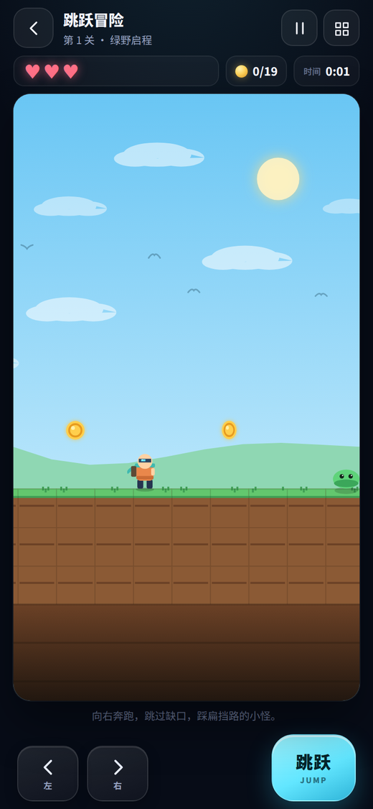

# 口袋游戏厅 · Pocket Arcade

手机优先、离线可玩的单机游戏合集。目前包含 **推箱子**、**俄罗斯方块**、**跳跃冒险**（原创横版跳跃）三款游戏，纯前端、无框架、无构建步骤，打开网页就能玩。

**在线试玩**：https://Qinyike.github.io/pocket-games/<br>
**GitHub**：https://github.com/Qinyike/pocket-games

<p align="center">
  
  
  
  
</p>

## 游戏

### 推箱子 · 24 关
- 24 个原创关卡，全部由反向生成器产出，并通过推动 BFS 验证可解与最少推动次数。
- 滑动棋盘、方向键、撤销、重开、选关、最佳步数。
- 卡在角落时会提示撤销。

### 俄罗斯方块 · 无尽
- 7-bag 随机、SRS 旋转与墙踢、暂存、幽灵方块、锁定延迟。
- 连击计分、每 10 行升级、最高分记录。
- 触屏大按钮和键盘都可用。

### 跳跃冒险 · 3 关
- 原创横版跳跃：奔跑、跳跃、踩怪、金币、尖刺、检查点、终点水晶。
- 固定时间步进物理，带土狼时间和跳跃缓冲，短按也有足够的跳跃高度。
- 三个关卡主题：绿野、落日、月下遗迹；支持关卡选择与最佳时间。

## 声音

- **全部音效由 WebAudio 合成**：跳跃、金币、踩怪、受伤、消除、过关等。
- **四首原创芯片音乐**：大厅、推箱子、俄罗斯方块、跳跃冒险各一首，不会播放任何现成游戏的旋律。
- 设置里可以分别关闭「音效」和「背景音乐」，偏好会保存在本机。

## 离线与更新

- Service Worker 预缓存全部页面、脚本、样式和图标，断网也能从桌面图标打开。
- 首页右上角有 **「更新」按钮**：
  - 有新版本时按钮变成「新版本」并亮起；
  - 点击后让新的 Service Worker 接管并自动刷新；
  - 没有更新时会提示当前版本。
- 版本号显示在首页脚注和设置面板中。

## 本地运行

需要 Node.js 20+（仅用于开发服务器和测试，游戏本身不需要 Node）。

```bash
npm run dev
# 打开 http://localhost:4173
```

也可以用任意静态服务器：

```bash
python3 -m http.server 4173
```

> Service Worker 需要 `localhost` 或 HTTPS 才能启用。

## 测试

```bash
npm test        # 推箱子 24 关求解、逻辑测试、俄罗斯方块引擎、平台关卡机器人通关
npm run check   # 入口与核心模块语法检查
```

平台关卡测试会让一个简单机器人用固定物理参数跑通三个关卡，防止改物理参数或关卡后出现不可通关。

## 目录结构

```text
.
├── index.html                  # 单页应用外壳
├── manifest.webmanifest        # PWA 清单
├── sw.js                       # 离线缓存与更新接管
├── src/
│   ├── main.js                 # 路由、设置、首页、更新入口
│   ├── core/                   # 存档、音效/音乐、震动、弹层、版本、更新
│   ├── games/sokoban/          # 推箱子逻辑、24 关、界面
│   ├── games/tetris/           # 俄罗斯方块引擎、界面
│   ├── games/platform/         # 横版跳跃物理、3 关、界面
│   └── styles/                 # 基础 / 推箱子 / 俄罗斯方块 / 跳跃冒险
├── scripts/
│   ├── generate-levels.mjs     # 推箱子反向生成器
│   ├── generate-icons.py       # PWA 图标生成（Pillow）
│   └── dev-server.mjs          # 零依赖开发服务器
├── test/                       # Node 内置测试
└── .github/workflows/          # CI + GitHub Pages 部署
```

## 操作

| 游戏 | 触屏 | 键盘 |
| --- | --- | --- |
| 推箱子 | 滑动棋盘 / 方向键 | 方向键、WASD、`Z` 撤销、`R` 重开 |
| 俄罗斯方块 | 左移 / 右移 / 左转 / 右转 / 下落 / 暂存 / 落下 | 方向键、`Z` 左转、`X` 右转、空格硬降、`C` 暂存、`P` 暂停 |
| 跳跃冒险 | 左 / 右 / 跳跃 | 方向键、A/D、空格/W/↑ 跳跃、`P` 暂停、`R` 重开 |

## 下一批经典离线游戏推荐

如果继续扩这个合集，我会按这个顺序做：

1. **2048**：规则简单、单手就能玩、每局 2–5 分钟，和现有卡片的节奏最搭。
2. **贪吃蛇**：竖屏单指操作，适合做每日挑战和最高分。
3. **扫雷**：经典耐玩，适合做难度分级和计时排行。
4. **打砖块**：触屏横移 + 反弹手感，和跳跃冒险共用一套渲染经验。
5. **五子棋 / 黑白棋**：本地双人或简单 AI，离线价值高。
6. **数独**：适合做题库、笔记和难度系统，但开发量比前几个大。

这些都可以沿用现在的基础设施：本地存档、原创芯片音乐、PWA 离线缓存和首页更新机制。

## 说明

「跳跃冒险」是受经典横版平台游戏启发的原创作品：没有使用任天堂的角色、关卡、像素图或音乐。三款游戏的关卡、视觉和音乐均为本项目原创。

## 许可

代码以 [MIT](LICENSE) 许可发布。
